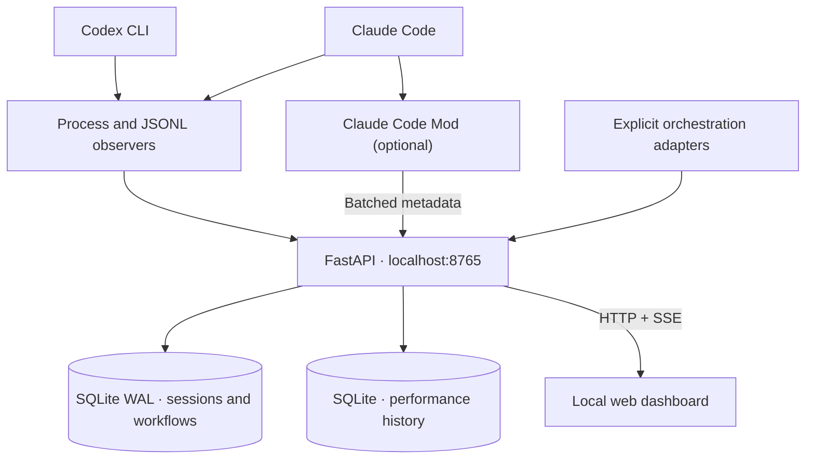

# Agent Workflow Monitor

**Local-first observability for AI coding agents and multi-agent workflows.**

Track Claude Code and OpenAI Codex from one dashboard: identify live agents, organize their conversations, follow execution timelines and handoffs, inspect available token/cost data, and measure the performance overhead of the monitor itself.

[](https://python.org)
[](https://fastapi.tiangolo.com)
[](https://sqlite.org)
[](LICENSE)


> **Early-stage software.** The web dashboard, local observers, Claude Code Mod, shared workflow API and explicit delegation tools are implemented at varying levels of maturity. Automatic correlation across all Codex and Claude processes, sessions and agents remains incomplete. Some integrations depend on evolving provider APIs.

## Why this project?

A development task can span a **Codex orchestrator**, multiple **Claude agents**, several conversations per agent and phases executed by different providers. Native CLI views don't provide a reliable cross-agent picture.

Agent Workflow Monitor helps answer:

- **What's running?** Which Codex and Claude processes are actually alive?
- **Who's working on what?** Which agent and conversation belong to the execution being monitored?
- **What happened?** Which steps completed, failed or await validation?
- **What did it consume?** Which token and USD cost figures are actually supported by provider data?
- **What's the overhead?** How much CPU, memory and latency does monitoring itself introduce?

## Features

| Capability | Current behavior |
| --- | --- |
| **Local agent discovery** | Detect Codex/Claude processes and incrementally read supported session JSONL files. |
| **Focused orchestrator view** | Select one live Codex as the primary process and display its related Claude agents instead of every Codex process. |
| **Agent-centric sessions** | Browse multiple Claude conversations per agent and native Codex subagent threads, with verified or explicitly confirmed associations. |
| **Workflow timeline** | Explore session steps, nested activity, states, timestamps and event history. |
| **Provider-neutral plans** | Define phases/subphases, ownership and handoffs across Codex, Claude and future adapters. |
| **Delegation tracking** | Explicitly supervised agent launches record the executor, orchestrator, PID, exit status and timestamps. |
| **Usage and cost reporting** | Show available input/output tokens and reported or estimated costs, with partial/unavailable labels. |
| **Claude Code Mod** | Native `/workflow` pane for local session state, subagents, tools and shared plans. |
| **Performance dashboard** | CPU, RAM, p95 latencies and event charts with bounded local history. |
| **Local API and SSE** | HTTP endpoints for sessions, workflow plans, agent mappings, events, metrics and live updates. |

**Process ≠ conversation ≠ workflow phase.** The monitor does not automatically claim that one agent delegated work to another based on similar timestamps, task titles or OS process ancestry.

## Architecture



**Local-first** means no Azure, AWS, cloud database or hosted monitoring service is required. The Python backend serves the web UI and listens on `127.0.0.1`.

## Installation

### Requirements

- **Windows 10/11** is the primary target. The Python backend can run on other platforms when CLI paths and dependencies are compatible.
- **Python 3.12+** and Git; the Windows scripts expect the `py` launcher.
- Optional: **Claude Code** and/or **Codex CLI**, installed separately. Neither is required for the demo.

### Quick start — Windows

```powershell
git clone https://github.com/joaquinsosamartin/agent-workflow-monitor.git
cd agent-workflow-monitor
.\scripts\start-windows.ps1
```

The script creates a virtual environment, installs dependencies and starts the backend. Open **http://127.0.0.1:8765**.

Use **Crear ejecución de demostración** to explore without an agent running. For real work, select the Codex process you're using and confirm the relevant Claude processes or conversations when a reliable automatic link is unavailable.

### Manual installation

```powershell
py -3 -m venv .venv
.\.venv\Scripts\python.exe -m pip install -r requirements.txt
.\.venv\Scripts\python.exe -m monitor serve
```

Cross-platform alternative:

```bash
python3 -m venv .venv
. .venv/bin/activate
pip install -r requirements.txt
python -m monitor serve --no-browser
```

To use a different port, run `python -m monitor serve --port 8766`. Note that the optional Claude Mod bridge currently uses port **8765**.

### Update an existing installation

Stop the running server first (`Ctrl+C`), then:

```powershell
git pull
.\.venv\Scripts\python.exe -m pip install -r requirements.txt
.\.venv\Scripts\python.exe -m monitor serve
```

Use **Ctrl+F5** to refresh the browser after UI updates.

## Using the dashboard

### Executions

The left panel focuses on one orchestrated job rather than displaying each detected process as a separate work session:

1. **Select the active Codex process** using its PID and start time.
2. **Associate the Claude processes** involved in that work where the relationship cannot be verified automatically.
3. **Open the sessions under an agent** to inspect its conversations, activity, workflow and available usage.
4. **Open a session** to see its detailed execution timeline.

Unlinked conversations remain in the collapsed history section. Process/session associations use PID plus process creation time to reduce incorrect reuse when Windows recycles a PID.

### Performance

The **Performance** tab displays backend CPU and memory, p95 latencies for JSONL scans/SQLite writes/dashboard/Claude hooks, and received/processed/dropped event counters. Select historical windows of **1, 6, 24 or 48 hours**. Samples are kept in a separate local SQLite database with default **15-second** sampling and **48-hour** retention.

## Claude Code Mod

The optional [Claude Code Mod](integrations/claude-mod/README.md) provides an embedded native pane. With the Python server running, start a new terminal:

```powershell
claude --version
claude plugin validate .\integrations\claude-mod
claude --plugin-dir .\integrations\claude-mod
```

Inside Claude Code:

```text
/workflow
```

The Mod displays session status, observed subagents, recent tools, context usage and shared workflow plans. A bounded, best-effort bridge sends selected metadata to the local backend. API compatibility depends on the Claude release and the surface where the Mod is loaded.

**Context-window occupancy is not billable token usage**; no USD charge is inferred from context size.

## Codex native subagents (thread-based, no Claude required)

Codex can launch **internal subagents as separate threads**, even when
Windows shows no additional agent executable. A `codex.exe`,
`codexbar.exe` or `codex-code-mode-host.exe` process is not
automatically a Codex subagent.

The JSONL observer now reads explicit `session_meta.payload.source.subagent.thread_spawn.parent_thread_id`
and the agent identity fields from child rollouts. This preserves the
real parent → child Codex hierarchy without guessing process ancestry
or reassigning usage from similarly timed conversations. The metadata
is indexed in `codex_agent_threads`; existing rollout headers are
backfilled during scans without reprocessing entire transcripts.

To inspect Codex subagents:

1. Start the backend and choose your live **Codex orchestrator process**.
2. In **Sesión del orquestador Codex**, select the actual *root
   conversation* for that process. This step is needed if the process
   doesn't expose its session UUID; the monitor will not guess.
3. View **SUBAGENTES CODEX** below it, including nested agents. Click
   any thread to open its own session and recorded timeline.
4. The right-hand orchestrator card shows Codex subagent threads and
   per-thread token counters when available.

Session selections are stored with the PID and its creation timestamp
and become invalid when that process ends. Codex subagent identity
comes from the **thread ID**, not from a PID. Child thread names, roles
and usage are shown only when provided by provider records.

**Limitations:** not all Codex versions persist the same metadata;
subagent activity may arrive before its rollout file is discovered;
the monitor cannot always tell which of several concurrently running
Codex root threads belongs to an unlabeled Codex process. In that case,
select the root session explicitly. Missing costs remain unavailable.
This feature does not require Claude Code or the Claude Mod.

## Codex integration and multi-agent workflows

Codex can be observed via its local session files. An opt-in [Codex skill](integrations/codex/README.md) and supervised wrapper allow explicit tracking of delegated work. They do **not** intercept every Codex process or automatically detect all delegations.

Install the skill for your local Codex setup on Windows:

```powershell
$target = Join-Path $HOME ".agents\skills\agent-workflow-delegate"
New-Item -ItemType Directory -Force -Path $target | Out-Null
Copy-Item .\integrations\codex\skills\agent-workflow-delegate\SKILL.md $target -Force
```

Restart Codex. After creating a workflow plan with the desired phase IDs (see [sample plan](examples/multi-agent-workflow.json)), track a delegated Claude execution using:

```powershell
.\.venv\Scripts\python.exe -m monitor delegate --plan pops-customer-api --phase qa --provider claude --agent qa-reviewer --orchestrator-provider codex -- claude -p "Review the implementation and report findings"
```

The wrapper records execution identity, PID, start/end time and exit status — **not the prompt or tool output**. A successful process exit leaves the phase **waiting for explicit acceptance**, rather than automatically declaring the work complete.

Read more in [Codex integration](integrations/codex/README.md).

## Technologies

| Layer | Stack |
| --- | --- |
| Runtime | Python 3.12+ |
| API | FastAPI, Uvicorn, Pydantic v2 |
| Storage | SQLite (WAL) |
| Process and session observation | psutil, incremental JSONL parsing |
| Frontend | HTML, CSS, vanilla JavaScript, SVG |
| Live updates | HTTP and Server-Sent Events (SSE) |
| Claude integration | Claude Code Mod (experimental JavaScript hooks) |
| Codex integration | CLI observer, delegation wrapper, local skill |
| Windows packaging | PyInstaller |
| Tests | Python unittest |

### Repository layout

```text
agent-workflow-monitor/
├── monitor/
│   ├── app.py                   # API and integration endpoints
│   ├── observer.py              # Incremental Claude/Codex JSONL reader
│   ├── process_watch.py         # Live process discovery
│   ├── topology.py              # Process relationships
│   ├── workflow_plan.py         # Provider-neutral plans
│   ├── workflow_delegation.py   # Explicit execution tracking
│   ├── performance_history.py  # Sampled metrics
│   └── static/index.html       # Web dashboard
├── integrations/
│   ├── claude-mod/              # Native Claude pane and bridge
│   └── codex/                   # Skill and setup
├── examples/                    # Multi-provider example
├── scripts/                     # Windows startup/build scripts
├── tests/                       # Offline tests
├── entry.py
└── requirements.txt
```

## Configuration and local storage

Configure settings through environment variables **before starting the backend**:

| Variable | Default | Description |
| --- | --- | --- |
| `AGENT_MONITOR_DATA` | `~/.agent-monitor` | Local data directory |
| `AGENT_MONITOR_OBSERVE` | `1` | Enable JSONL discovery; `0` disables it |
| `AGENT_MONITOR_POLL_SECONDS` | `5` | JSONL scan interval |
| `AGENT_MONITOR_LOOKBACK_HOURS` | `12` | Recent transcript discovery period |
| `AGENT_MONITOR_DASHBOARD_SECONDS` | `10` | Web dashboard refresh |
| `AGENT_MONITOR_PERF_INTERVAL_SECONDS` | `15` | Performance sampling |
| `AGENT_MONITOR_PERF_RETENTION_HOURS` | `48` | Metrics retention |
| `AGENT_MONITOR_METRIC_SAMPLES` | `300` | Rolling latency sample capacity |

By default, the monitor writes:

```text
~/.agent-monitor/
├── monitor.db       # Sessions, events, usage, agent relationships and plans
├── performance.db   # CPU, memory, latency and event samples
└── api.key          # Local API write key
```

Claude transcripts are usually under `~/.claude/projects` and Codex session data under `~/.codex/sessions` (also some Windows AppData locations). Use `CLAUDE_CONFIG_DIR` or `CODEX_HOME` for custom locations. A native Windows monitor does not automatically read WSL sessions.

### Privacy and security

- The backend **binds to localhost** (`127.0.0.1`) and requires no cloud account.
- API mutations require `X-Monitor-Key`. The localhost bootstrap exposes the key to the local browser; **this mechanism is not suitable for an internet-facing deployment**.
- The observer does not intentionally store full prompts, tool arguments, outputs or code, but **short session titles can be derived from user instructions**. Treat the databases as potentially sensitive.
- Cost and token totals are labeled as **reported**, **estimated**, **partial** or **unavailable** where supported. Subscription prices are not identical to API token charges.
- A process being a child of another process does **not** by itself confirm that work was delegated between coding agents.
- Local data remains on your machine unless you explicitly share or export it.

## API

Useful endpoints (many write operations require `X-Monitor-Key`):

| Endpoint | Purpose |
| --- | --- |
| `GET /api/health` | Basic health |
| `GET /api/dashboard` | Process, session, focus and association snapshot |
| `GET /api/observer` | Session-discovery diagnostics |
| `GET /api/runs/{id}` | Session details, timeline and usage |
| `GET /api/runs/{id}/events` | Live SSE stream |
| `GET /api/workflows` | Shared plans |
| `GET /api/workflows/{id}` | Phases and owner history |
| `GET /api/workflows/{id}/executions` | Delegated execution records |
| `GET /api/performance` | Live performance metrics |
| `GET /api/performance/history?hours=6` | Historical performance samples |
| `POST /api/integrations/claude/events/batch` | Ingest Claude Mod telemetry |

With the server running, use [FastAPI's interactive API docs](http://127.0.0.1:8765/docs) for the full route catalog.

## Standalone Windows build

```powershell
.\scripts\build-windows.ps1
.\dist\agent-monitor.exe
```

The PyInstaller build must be produced on Windows. The script creates a local executable; **no prebuilt or signed installer is promised**. Validate the resulting EXE on its target machine.

## Tests

```powershell
.\.venv\Scripts\python.exe -m unittest discover -s tests -v
```

Offline tests cover core components including observer behavior, workflow plans and handoffs, explicit session associations and performance collection. Integration behavior depends on installed provider versions and must be tested locally.

## Roadmap

| Area | Status | Next steps |
| --- | --- | --- |
| Local core and web dashboard | **Implemented, iterating** | Hardening and UX improvements |
| Claude Code Mod | **Experimental implementation** | Native event compatibility, better workflow integration |
| Codex workflow/delegation | **Partially implemented** | Automatic app-server/SDK event integration |
| Agent/session correlation | **In progress** | Verified automatic Codex → Claude → session identities |
| Token and cost attribution | **Partial** | Per-agent and per-phase evidence-backed accounting |
| Orca side panel | **Planned** | Embedded frontend using shared API |
| Performance and packaging | **Implemented in part** | Benchmarking, regressions, installer and releases |
| Reliability | **Ongoing** | Full integration tests and version compatibility |

### Known limitations

- A single working Codex may be represented by several live OS processes; selecting the primary process can require user confirmation.
- Claude CLI processes can own multiple conversations, and reliable automatic agent/session association is not always available.
- OS ancestry and matching task titles do not prove orchestration.
- Provider-specific JSONL and Mod APIs may change.
- Some token totals and dollar costs are unavailable; **no cost should be invented**.
- This is a **local single-user developer tool**, not a hardened multi-tenant monitoring service.

## Contributing

Suggestions, bug reports and pull requests are welcome where repository permissions allow. Include OS, Python and CLI versions and sanitized diagnostics. **Never post API keys, private prompts, transcript contents or sensitive paths.**

## License

Distributed under the [MIT License](LICENSE).

---

<sub>Made with ❤️ by <a href="https://joaquinsosa.es">joaquinsosa.es</a>.</sub>
